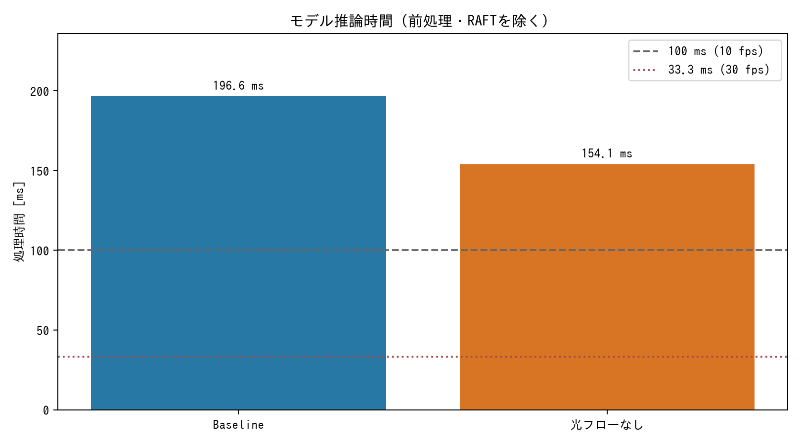
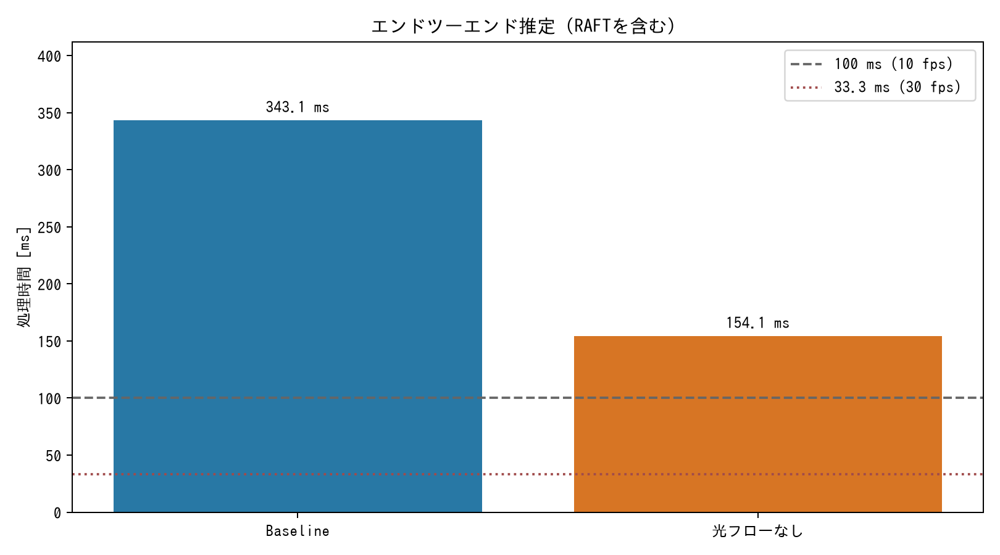
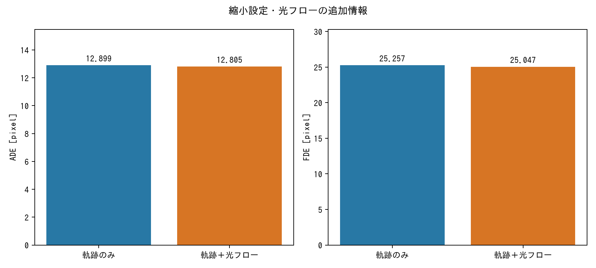
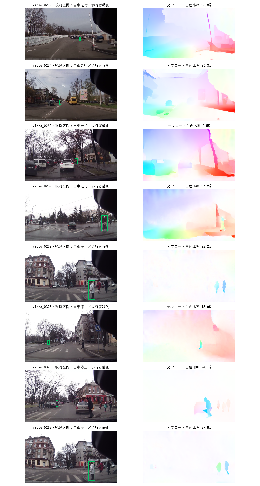
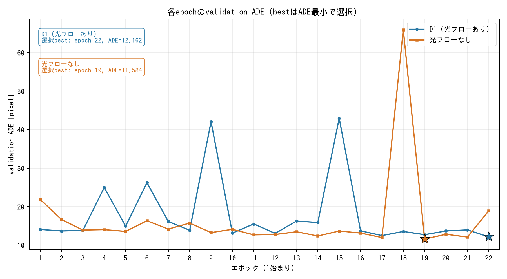

# 実験：オプティカルフロー除去（exp/yan-noflow）

先端 AI 実践 グループ A ／ エン イベイ

中間発表の「進捗」スライドに載せた実験の説明です。どんな設定で、どういう考えで進めたかをまとめています。分かりにくい用語は最後の「用語」にまとめています。

> **結論（先に）**
> - フローを省くと、モデル推論時間は **196.6 → 154.1 ms（−42.5 ms、約 22% 短縮）**。軌跡予測の誤差は悪化しなかった（ADE 12.14 → 11.62 px）。
> - 学習済みの PTINet は、もともとフローをほとんど使っていなかった。
> - ただし、学習は各条件 1 回のみ、JAAD・0.5 秒先のみ。横断予測は両モデルとも学習できておらず、比較できなかった。

---

## 1. 目的

PTINet は計算量が大きく、目標の速度に届いていない。中でもオプティカルフロー（以下、フロー）は、事前に RAFT で計算する必要があるうえ、モデルの中でも特徴抽出に時間がかかる。一方、原論文では、フローを省いても精度の低下は小さいと報告されている。

そこで、フローを省いた PTINet を実際に学習し、**どれだけ速くなるか**、**精度は保たれるか**を確かめた。

## 2. 実験の設定

| 項目 | 内容 |
|---|---|
| 比較したもの | **フローあり**：公開コードの PTINet（明らかな誤り 2 点だけ修正）＝ `baseline-corrected` ブランチ。 **フローなし**：フローの入力と特徴抽出を取り除き、同じ条件で最初から学習し直したもの。 フローを外す切り替えを追加した後も、フローありの設定では、追加前のコードと出力が完全に一致することを確認した。 |
| 修正した 2 点 | ① validation で評価するときに、評価用の設定（`net.eval()`）に切り替えていなかった。 ② 横断予測の最後の層に余計な処理（ReLU）があり、「横断する」と出力しにくくなっていた。 モデルの構造は変えていない。 |
| データ | JAAD。学習は train 全体、評価は validation（616 系列）。過去 16 フレーム（約 0.5 秒）から 0.5 秒先を予測。 |
| 学習 | 公開コードの設定（22 epoch、学習率 0.001、バッチサイズ 2）、seed 0、各条件 1 回。学習中に validation の ADE が最も小さかった回のモデルを使う。全データの学習は 1 回約 8 時間。なお、原論文に書かれた学習率は 0.0001。 |
| 縮小設定 | 実験 4 のみ。時間短縮のため、学習データを動画の 25%（ID 順の先頭）に減らし、画像を 120×213 に縮小。評価は validation 全体。 |
| 時間の測り方 | 入力を用意してから、横断予測と軌跡予測の出力が出るまで（フローの計算 RAFT は含まない）。1 件ずつ処理し、100 サンプルの中央値。 |
| 修正していない点 | 原論文と公開コードで異なるが、今回はそのままにした点：画像を縮小するときの縦横の指定、画像の処理（ConvLSTM）に 16 フレーム中 5 フレームだけを使う点、同じ特徴を 2 回足している箇所、フローを色付き画像（960×540）として保存して読み込む点。いずれもフローあり／なしで共通。 |
| PC | GPU：AMD Radeon RX 9070 XT、CPU：Ryzen 7 7700、Windows の WSL2、PyTorch 2.9.1（ROCm 7.2.1）。フローの計算は RAFT（公式の学習済みモデル、20 回反復）。 |
| コードの版 | 下の「コードの版」を参照。フローありモデルは Git 導入前に学習したため、学習時のコードの控え（snapshot）を保存している。 |

推論時間は GPU によって変わるため、別の PC で比べる場合は、**同じ PC でフローあり／なしの両方を測る**必要がある。

## 3. 前提：公開コードで原論文の結果を再現できるか

比較の前に、公開コードで原論文に近い精度が出るかを確認した（JAAD の test、修正前の公開コードのまま）。0.5 秒先は原論文とほぼ同じ精度が出ており、比較の土台として使えると判断した。1・1.5 秒先は原論文より誤差が大きい。

| 予測時間 | 原論文 ADE / FDE | 再現 ADE / FDE |
|---|---|---|
| 0.5 秒 | 11.25 / 20.60 | **11.47 / 21.31** |
| 1.0 秒 | 22.26 / 46.30 | 24.11 / 49.59 |
| 1.5 秒 | 42.05 / 98.23 | 54.59 / 137.53 |

この節の数値と 4 節以降の数値は直接比べられない。この節は test・修正前のコード、4 節以降は validation・修正後のコードで計算しているため、同じ 0.5 秒先でも値が異なる（例：ここでは ADE 11.47、4 節のフローありは 12.14）。

原論文の推論時間（103 ms）は、測った機器や範囲が書かれていないため、今回の数値とは直接比べず、同じ PC で測った値どうしで比べることにした。

## 4. 実験の流れと結果

実験は 3 段階で進めた。まず改善案そのものの効果（速さと精度）を確かめ、次に精度が落ちない理由を調べ、最後に結果が偶然でないかを確認した。

| 実験 | 確かめたこと | 方法 | 結果 | 言えること |
|---|---|---|---|---|
| 1 | 速くなるか | 同じ PC でフローあり／なしの推論時間を実測 | 196.6 → 154.1 ms | 約 22% 短縮 |
| 2 | 精度は落ちないか | フローなしを学習し直し、validation で評価 | ADE 12.14 → 11.62 FDE 23.88 → 22.98 | 軌跡は悪化しない（横断は比較できない） |
| 3 | フローは使われているか | 学習済みモデルの入力を 1 つずつ 0 にする | フロー 0：ほぼ変化なし 画像 0：ADE +2.71 | モデルはフローをほとんど使っていない |
| 4 | フローに情報はあるか | 軌跡のみ vs 軌跡＋フローを学習（縮小設定） | ADE 12.90 vs 12.81 | フローの情報は軌跡でほぼ代わりが効くと考えられる |
| 5 | フローは正しく作れているか | 映像とフロー画像を 8 例並べて確認 | 動きは表れている | 目視（8 例）では、作り方に大きな問題は見られない |
| 6 | 差は偶然か | 動画単位の 95% 信頼区間、場面別の比較 | −1.00〜+0.03 px（0 を含む） 6 場面中 5 場面で同等以下 | 「悪化なし」とは言えるが「改善」とは言えない |
| 7 | たまたま良い回か | 学習途中の全 22 回の誤差を比較 | 15 回で同等以下 | 特定の回だけの結果ではない。ただし学習は不安定 |

### 4.1 速くなるか、精度は落ちないか（実験 1・2）

同じ PC でフローあり／なしの推論時間を測り（実験 1）、両モデルを同じ validation データで評価した（実験 2）。推論時間は 42.5 ms（約 22%）短くなり、軌跡予測の誤差は悪化しなかった。短くなった分は、フローの特徴抽出の時間にあたる。残りの時間の大部分は画像の処理である。

| 指標 | フローあり | フローなし | 差 |
|---|---|---|---|
| 推論時間 [ms] | 196.6 | **154.1** | −42.5 |
| ADE [px] | 12.14 | **11.62** | −0.52 |
| FDE [px] | 23.88 | **22.98** | −0.90 |
| F1 ／ 正解率 | 0.00 ／ 0.883 | 0.00 ／ 0.883 | — |
| パラメータ数 | 49.4 M | 20.6 M | −28.8 M |

横断予測は、両モデルとも全てのデータを「横断しない」と予測しており（F1 = 0）、フローの影響は比べられなかった。正解率 0.883 は「横断しない」データの割合（全体の 88.3%）そのものである。参考として、横断予測の PR-AUC は 0.22 → 0.14 に下がった（でたらめに予測した場合は 0.12）。ただし、両モデルとも出力がほぼ一定であり、この差に意味があるかは分からない。

推論時間について、参考となる数値もまとめておく。RAFT（フローの計算）は評価方法では前処理として含めないが、実際の車で毎フレーム計算する場合は、その時間も必要になる。

| 条件 | モデル推論時間 | RAFT | 合計（参考・推定） |
|---|---|---|---|
| フローあり | 196.6 ms | 146.5 ms | 343.1 ms |
| フローなし | 154.1 ms | 不要 | 154.1 ms |
| 画像なし（参考） | 51.5 ms | 146.5 ms | 198.1 ms |
| フローあり・RAFT を 426×240 で計算（参考） | 196.6 ms | 47.1 ms | 243.7 ms |

RAFT は 960×540 で 20 回反復した場合の値。合計は RAFT 1 回とモデル推論 1 回の和で、データの読み込みなどは含まない。

### 4.2 なぜ精度が落ちないのか（実験 3〜5）

精度が落ちないのは、学習済みの PTINet がもともとフローを使っていないからではないかと考えた。そこで、フローありモデルの入力を 1 つずつ 0 にして、誤差がどれだけ増えるかを見た（実験 3、学習し直しはしない）。

- 画像を 0 にすると ADE は 12.14 → 14.84 px（+2.71）、FDE は 23.88 → 28.23 px（+4.36）と悪化した。
- フローを 0 にしても、ADE・FDE ともにほとんど変わらなかった（約 −0.001 px）。場面別に見ても、変化はどの場面でもほぼ 0 であった。

モデルはフローをほとんど使っていないと言える。原論文でもフローの影響は小さい。

ただし、これだけでは「フローに情報はあるが、モデルがうまく使えていないだけ」という可能性が残る。そこで、軌跡だけのモデルと、軌跡にフローを加えたモデルを学習して比べた（実験 4、時間短縮のため縮小設定）。ADE は 12.90 px と 12.81 px で、ほとんど差がなかった。フローの情報は、軌跡（過去の位置と速度）でほぼ代わりが効くと考えられる。

さらに、フローの作り方に問題があって情報が入っていない可能性も考え、validation から 8 例を選び、映像とフロー画像を並べて確認した（実験 5）。自車が走っている場面では画面全体に色（動き）があり、ほぼ白い部分は約 10〜30% であった。自車が止まっている場面では、4 例中 3 例で 9 割以上がほぼ白で、歩行者の部分にだけ色が表れていた。フローには動きが表れていることを確認した。

なお、フローの作り方は原論文の記述と一部異なる。どちらも RAFT で計算しているが、公開コードではフローを色付きの画像（960×540）として保存して読み込んでおり、原論文は 240×420 で入力したと書かれている。

### 4.3 結果は偶然ではないか（実験 6・7）

同じ動画から作ったデータは互いに似ているため、1 件ずつ数えると、差を実際より確かに見てしまうおそれがある。実際、1 件ずつの検定（Wilcoxon 符号順位検定）では p = 0.0007、1 件ずつ数えた 95% 信頼区間は −0.95〜−0.08 px で、差があるように見える。

そこで、ADE について、動画ごとにまとめて差の範囲（95% 信頼区間）を求め直した（実験 6）。結果は **−1.00〜+0.03 px で 0 を含んだ**。つまり、「悪化していない」とは言えるが、「良くなった」とまでは言えない。

| 場面 | 件数 | フローあり | フローなし | 差 |
|---|---|---|---|---|
| 横断する | 72 | 15.81 | 14.51 | −1.30 |
| 横断しない | 544 | 11.65 | 11.24 | −0.41 |
| 歩行者が移動中 | 585 | 12.41 | 11.88 | −0.53 |
| 歩行者が静止 | 31 | 6.97 | 6.71 | −0.26 |
| 自車が走行中 | 571 | 12.30 | 11.71 | −0.60 |
| 自車が停止 | 45 | 10.00 | 10.52 | **+0.52** |

場面別の ADE [px]。場面は重なっているため、件数の合計は 616 にならない。歩行者の移動／静止は観測期間中の枠の移動量（5 px 超を移動）で判定。6 場面中 5 場面でフローなしの誤差が同じか小さかった。自車が止まっている場面のみ悪化したが、件数が 45 件と少なく、はっきりしない。

また、学習で保存したモデルが、たまたま良い回のものだった可能性も考えた。学習途中の 22 回分の誤差を比べると（実験 7）、15 回でフローなしの誤差が同じか小さく、特定の回だけの結果ではなかった。一方で、両モデルとも誤差が大きく跳ねる回があり（フローありは最大 43 px、フローなしは最大 66 px）、学習が不安定であることも分かった。学習率が原論文の記載より 10 倍大きいことが一因の可能性があるが、確かめていない。

## 5. まとめと注意点

**分かったこと**
- フローを省くと、推論時間は約 22% 短くなり、軌跡予測の誤差は悪化しなかった。
- 学習済みの PTINet はフローをほとんど使っておらず、フローの情報も軌跡でほぼ代わりが効くと考えられる（実験 4 は縮小設定・1 回の結果）。そのため、フローを省く方向は妥当と考える。
- 残りの推論時間の大部分は画像の処理（約 145 ms）である。ただし、画像を 0 にすると誤差が大きく悪化するため、単純には省けない。

**注意点**
- 学習は各条件 1 回のみ。データは JAAD、0.5 秒先のみ（1・1.5 秒先、TITAN は未実施）。
- 横断予測は両モデルとも学習できておらず、フローの影響は分かっていない。
- 両モデルとも学習中に誤差が大きく跳ねる回があり、学習が不安定である（原因は未確認）。
- 推論時間の内訳は、3 つのモデルの時間の差から推定したもの（合計は実測）。
- 比較実験の評価はすべて validation。test は最終確認のために残しており、比較実験では使っていない（3 節の再現確認のみ test を使用）。

**現在の状況**
- TITAN：データのダウンロード期限が切れたため再申請中。読み込みのコードは準備済み（`results/exp_yan_noflow/titan_code_prepare/`、データは含まない）。
- 1・1.5 秒先：未実施。

## 6. 結果ファイルの場所

| フォルダ | 中身 |
|---|---|
| `results/exp_yan_noflow/step1_prepare/` | 切り替えの追加と動作確認（コードの差分を含む） |
| `results/exp_yan_noflow/step2_timing/` | 推論時間・RAFT の実測（実験 1） |
| `results/exp_yan_noflow/step3_masking/` | 入力を 0 にした実験（実験 3）、場面別 |
| `results/exp_yan_noflow/step4_jaad_noflow/` | フローなしの再学習と評価（実験 2）、統計検定（実験 6）、`epoch_curves/`（実験 7） |
| `results/exp_yan_noflow/step5_information/` | 軌跡のみ vs 軌跡＋フロー（実験 4） |
| `results/exp_yan_noflow/step6_images/` | フロー画像の確認（実験 5） |
| `results/exp_yan_noflow/step9_figures/` | 発表用の図と表 |
| `results/exp_yan_noflow/titan_code_prepare/` | TITAN 用の読み込みコード（データなし） |

各フォルダの README に、実行したコマンド、所要時間、指示との違いを書いている。

## 7. コードの版

| 内容 | 本機の Commit ID | GitHub 上の Commit ID |
|---|---|---|
| 実験に使ったコード（フローなし・評価・時間計測） | `fa962404` | （推送後に記入） |
| フローありモデル（D1）の学習時のコード | Git 導入前。控え：`15221374` | （推送後に記入） |

## 8. 用語

| 用語 | 意味 |
|---|---|
| オプティカルフロー | 連続する 2 枚の画像から、各点がどちらにどれだけ動いたかを表したもの。RAFT というモデルで事前に計算する。 |
| ConvLSTM ／ ResNet-50 | PTINet の中の部品。ConvLSTM は連続する画像を処理する部分、ResNet-50 はフロー画像から特徴を取り出す部分。フローを省くと ResNet-50 の部分が不要になる。 |
| ADE ／ FDE | 予測した歩行者の位置と正解のずれ（px＝画像上のピクセル数）。ADE は予測期間全体の平均、FDE は最後の時刻。小さいほど良い。 |
| F1 ／ 正解率 | 横断予測（横断する／しない）の評価。F1 は「横断する」をどれだけ当てられたかを表す。正解率は全体のうち当たった割合。 |
| PR-AUC | 横断予測の評価の一つ。「横断する」をどれだけ上位に予測できているかを 0〜1 で表す。でたらめに予測した場合は「横断する」データの割合（今回は 0.12）になる。 |
| Wilcoxon 符号順位検定 | 同じデータで 2 つのモデルの誤差を比べ、差があると言えるかを調べる方法。p が小さいほど差がありそうと判断する。 |
| 95% 信頼区間 | 差の本当の値がおおよそ入る範囲。0 を含む場合、差があるとは言い切れない。今回は、データを繰り返し抜き出して計算する方法（bootstrap）で求めた。 |
| validation ／ test | どちらも学習に使わないデータ。validation は開発中の評価用、test は最後の確認用。今回の比較の数値はすべて validation で計算した。 |
| epoch ／ seed | epoch は学習データを 1 周すること。seed は乱数の種で、変えると学習結果も少し変わる。 |
| パラメータ数 | モデルが学習する重み（数値）の数。M は百万。多いほどモデルが大きい。 |
