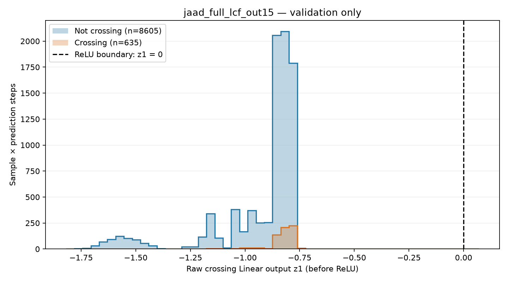
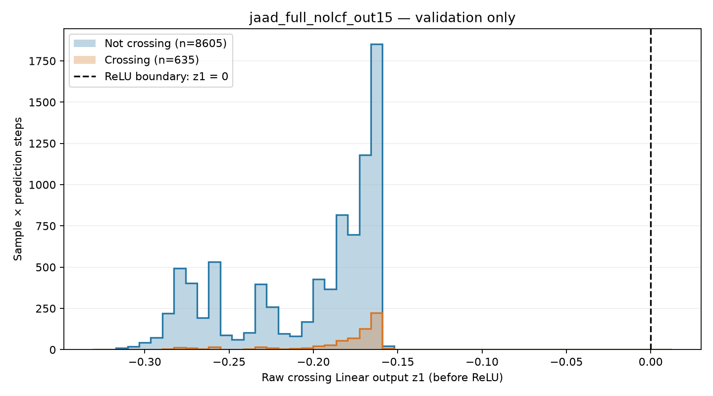
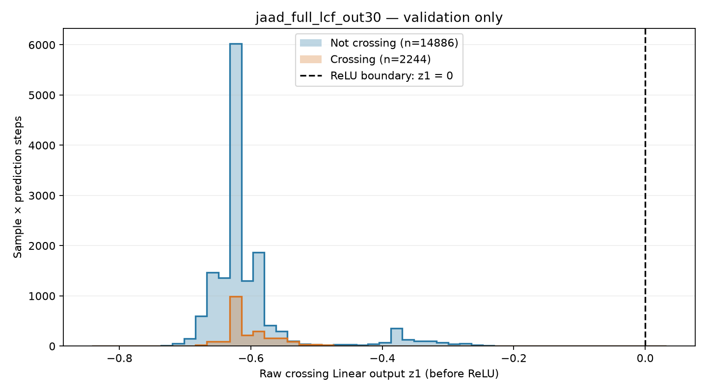
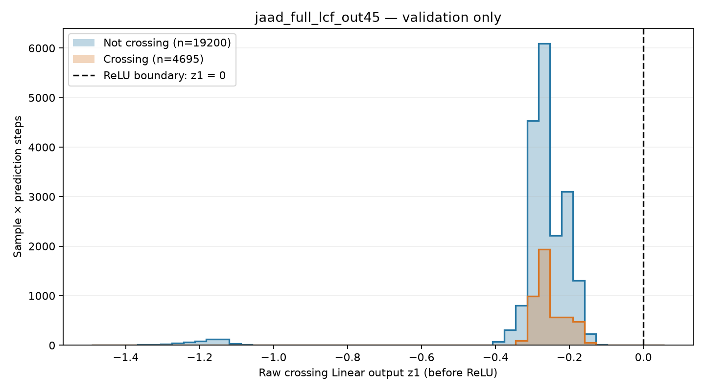

# Crossing 输出 ReLU：validation 检查

更新时间：2026-11-22T20:59:08.451531+09:00。仅推理，仅 validation；无训练、无 test 访问、无原代码/checkpoint 修改。

## 运行方式

```bash
HSA_ENABLE_DXG_DETECTION=1 PYTHONDONTWRITEBYTECODE=1 python LOCAL_EXPERIMENT/PTINet/tools/diag_relu_val.py
```

四组依次运行，batch=2、workers=8、shuffle=False、drop_last=False、eval/no_grad、seed=0；每组限时30分钟。沿用原 venv、预训练缓存及各 run 最佳 checkpoint。保存 hook 每步原始 Linear 输出，按调用顺序 stack 为 [B,T,2]，与最终输出形状逐批核对，并重建 softmax(ReLU(z)) 核验概率。

## 汇总

|Run|z1≤0|z0≤0|两者≤0|p=0.5|p=0.5 中两者≤0|原始 margin AUC / AP|本次概率 AUC / AP|上一轮概率 AUC / AP|用时(s)|
|---|---:|---:|---:|---:|---:|---|---|---|---:|
|jaad_full_lcf_out15|100.00%|0.00%|0.00%|0.00%|不适用（无0.5）|0.505387 / 0.141026|0.505387 / 0.141139|0.505387 / 0.141139|190.2|
|jaad_full_nolcf_out15|100.00%|0.00%|0.00%|0.00%|不适用（无0.5）|0.538424 / 0.148623|0.537658 / 0.148071|0.537658 / 0.148071|187.8|
|jaad_full_lcf_out30|100.00%|0.00%|0.00%|0.00%|不适用（无0.5）|0.667133 / 0.377986|0.666809 / 0.374952|0.666809 / 0.374952|177.8|
|jaad_full_lcf_out45|100.00%|5.29%|5.29%|5.29%|100.00%|0.743962 / 0.591003|0.727215 / 0.535797|0.727215 / 0.535797|167.6|

前五个比例的分母是样本×未来步；条件比例的分母仅为 p=0.5 的样本×步，若无该事件则留空。与上一轮报告的系列最大概率等于0.5比例不可混用。AUC/AP按系列计算：原始得分=max_t(z1−z0)，最终得分=max_t p1，标签=cross_label。AP基线是各组系列正例比例，见summary.csv。

## 参数与 z1 分布

|Run|weight[0] L2|weight[1] L2|bias0|bias1|
|---|---:|---:|---:|---:|
|jaad_full_lcf_out15|1.10758748|0.410706733|0.077218391|-0.0255292039|
|jaad_full_nolcf_out15|0.828050484|0.306063594|0.116466589|0.0103470869|
|jaad_full_lcf_out30|1.03614299|0.713037592|0.0971256718|-0.0471325815|
|jaad_full_lcf_out45|1.20177985|0.597373963|0.134573191|-0.0527414866|

|Run|真实逐步标签|min|25%|median|75%|max|
|---|---|---:|---:|---:|---:|---:|
|jaad_full_lcf_out15|不横穿|-1.74834895|-0.949667633|-0.852859735|-0.800821066|-0.758355141|
|jaad_full_lcf_out15|横穿|-1.57196176|-0.853585064|-0.806491852|-0.796111554|-0.759193599|
|jaad_full_nolcf_out15|不横穿|-0.318053216|-0.240144178|-0.184119612|-0.166925117|-0.15824683|
|jaad_full_nolcf_out15|横穿|-0.296680599|-0.185849212|-0.169942349|-0.163415886|-0.157949269|
|jaad_full_lcf_out30|不横穿|-0.809352875|-0.630480111|-0.622048259|-0.594902158|-0.14325884|
|jaad_full_lcf_out30|横穿|-0.72456634|-0.622450978|-0.61852628|-0.581021905|-0.319162041|
|jaad_full_lcf_out45|不横穿|-1.43438661|-0.290282778|-0.269648463|-0.223620031|-0.115703821|
|jaad_full_lcf_out45|横穿|-1.29775321|-0.281750157|-0.265633702|-0.226569645|-0.120741472|

## 代码只读确认

训练 crossing loss 是 nn.BCELoss，输入为模型 softmax 后的两类概率及 future_cross 两列 one-hot；每步计算后按输出步数平均，加入 speed_loss + crossing_loss + mloss。不是 BCEWithLogitsLoss，也不是直接把 Linear logits 传入 loss。

evaluate() 使用模型返回的 intentions；模型先 torch.argmax(crossing_outputs,dim=2)，再跨步 torch.max。两类相等时 argmax 返回第一个最大值即class0，实际 hook 推理也逐样本核验严格 >0.5 与返回 intention 一致。fc_attrib 同样是 Linear 后接 ReLU（只记录，不分析）。

`model/network_image.py:88–92`
```python
88:         self.fc_crossing = nn.Sequential(nn.Linear(in_features=args.hidden_size, out_features=2), nn.ReLU())
89:         self.fc_attrib = nn.Sequential(nn.Linear(in_features=args.hidden_size, out_features=3), nn.ReLU())
90:         
91:         self.hardtanh = nn.Hardtanh(min_val=-1*args.hardtanh_limit, max_val=args.hardtanh_limit)
92:         self.softmax = nn.Softmax(dim=1)
```

`model/network_image.py:250–262`
```python
250:         for i in range(self.args.output//self.args.skip):
251:             hdc, zdc         = self.crossing_decoder(in_cr, (hdc, zdc))
252:             crossing_output  = self.fc_crossing(hdc)
253:             in_cr            = self.pos_embedding(hdc).detach()
254:             crossing_output  = self.softmax(crossing_output)
255:             crossing_outputs = torch.cat((crossing_outputs, crossing_output.unsqueeze(1)), dim = 1)
256: 
257:         outputs.append(crossing_outputs)
258:     
259:         if average:
260:             crossing_labels = torch.argmax(crossing_outputs, dim=2)
261:             intention = torch.max(crossing_labels,dim=1)[0]
262:             outputs.append(intention)
```

`train.py:154–154`
```python
154:     bce = nn.BCELoss()
```

`train.py:204–211`
```python
204:             crossing_loss = 0
205:             for i in range(future_cross.shape[1]):
206:                 crossing_loss += bce(crossing_preds[:,i], future_cross[:,i])
207:                 
208:             crossing_loss /= future_cross.shape[1]
209:             
210:             loss = speed_loss + crossing_loss + mloss
211:             loss.backward()
```

`train.py:404–418`
```python
404:         for b in loader:
405:             t = {k: (v.to(DEV) if torch.is_tensor(v) else v) for k, v in b.items()}
406:             _, speed_preds, crossing_preds, intentions = net(speed=t['speed'], pos=t['pos'], ped_attribute=t['ped_attribute'],
407:                 ped_behavior=t['ped_behavior'], scene_attribute=t['scene_attribute'], images=t['image'], optical=t['optical'], average=True)
408:             preds_p = utils.speed2pos(speed_preds, t['pos'])
409:             bs = t['pos'].shape[0]
410:             ade += float(utils.ADE(preds_p, t['future_pos'])) * bs
411:             fde += float(utils.FDE(preds_p, t['future_pos'])) * bs
412:             aiou += float(utils.AIOU(preds_p, t['future_pos'])) * bs
413:             fiou += float(utils.FIOU(preds_p, t['future_pos'])) * bs
414:             n += bs
415:             state_targets.extend(t['future_cross'][:, :, 1].reshape(-1).cpu().numpy())
416:             state_preds.extend(np.argmax(crossing_preds.reshape(-1, 2).cpu().numpy(), axis=1))
417:             intent_preds.extend(intentions.reshape(-1).cpu().numpy())
418:             intent_targets.extend(t['cross_label'].reshape(-1).cpu().numpy())
```

## 判断与依据

四个 checkpoint 在本轮 val 的每一个样本、每一个未来步上，z1 都处于 ReLU 非正区间，横穿通道输出被截为0。另一通道 ReLU 后非负，因此 softmax 的横穿概率必然≤0.5；严格>0.5及原argmax平局归class0共同导致全判负类。该推断由 hook 原始输出、逐批概率重建、原模型intention一致性共同支持。

out45 的逐步 p=0.5 占 5.2856%（1263/23895），其中两路均≤0占 100.00%，无例外。此前35.97%指系列最大概率等于0.5，分母不同。前3组没有逐步p=0.5。

out45 截断前系列margin的AUC/AP为 0.743962/0.591003，最终概率为 0.727215/0.535797，说明ReLU也抹掉了一部分排序信息。另有 2.7495% 的样本×步在截断前z1>z0，截断后该比例为0。

out15两组及out30的原始margin与最终概率AUC非常接近。特别是out15仍约0.505/0.538，不能把弱区分度完全归咎于ReLU，也不能声称移除ReLU就能恢复良好性能。结论是：本轮val上的横穿通道截断与全负类输出机制成立；训练时为何进入此状态、去除ReLU后重新训练会怎样，仍未验证。


## 证据与限制

- 保留每个样本每一步的 z0、z1、概率、真实逐步标签于 *_steps.csv，系列原始margin及最终概率于 *_series.csv，可独立复算。原始logit差仅作为诊断得分，未替换模型输出或修改模型。
- *_protected_before/after.json 记录受保护源码/缓存的哈希、大小、mtime；每组同时验证 checkpoint 哈希未变。
- 固定同一seed、batch、数据次序；*_result.json 记录本次概率与上一轮逐步概率是否完全相同及最大差。原VAE在eval中仍随机采样，保留该行为。
- 这只能验证现有checkpoint在val上的截断机制和排序信息，不能证明训练期梯度的完整历史，不能证明移除ReLU并重训后的性能。不同输出长度的样本及正例比例不同，跨组AP不代表固定人群改善。

### jaad_full_lcf_out15
checkpoint：`LOCAL_EXPERIMENT/runs/jaad_full_lcf_out15/model_best0.001_512.pkl`；SHA256：`9466147e52e458d232f5a99d33e0cfab2e38fbc192ef086306ce257fa3752c35`。


### jaad_full_nolcf_out15
checkpoint：`LOCAL_EXPERIMENT/runs/jaad_full_nolcf_out15/model_best0.001_512.pkl`；SHA256：`f4bcfcb745e80e1321d4ab0fbd84d144b6b492d2451dd8264d891a6875b46fa3`。


### jaad_full_lcf_out30
checkpoint：`LOCAL_EXPERIMENT/runs/jaad_full_lcf_out30/model_best0.001_512.pkl`；SHA256：`c53b3921d7162abf50233e700f9a5922edcb07edaa964c1bc47f15ef0d5166e5`。


### jaad_full_lcf_out45
checkpoint：`LOCAL_EXPERIMENT/runs/jaad_full_lcf_out45/model_best0.001_512.pkl`；SHA256：`39d45ef25a03b18ea454b52245a3e2b88105690eb8e9dbe06dec5e1ebf8fd6f1`。

