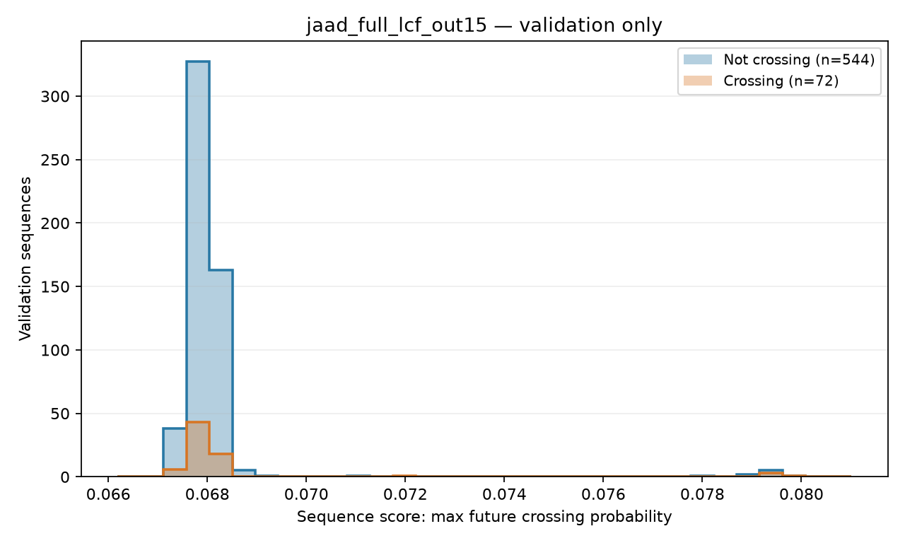
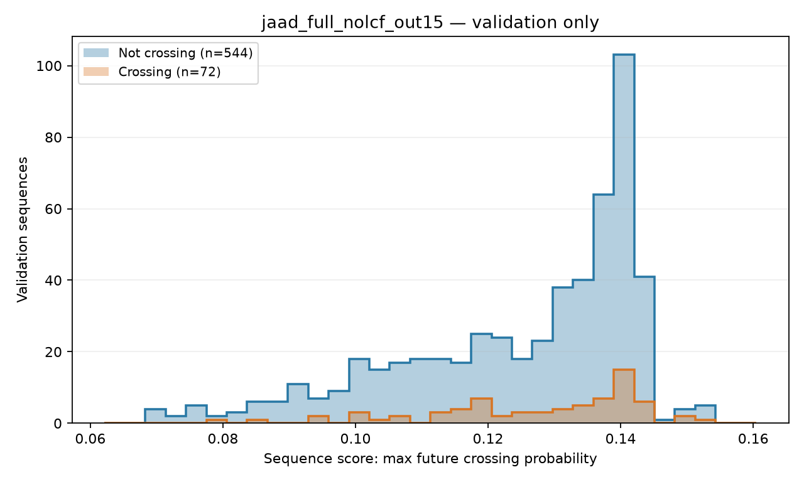
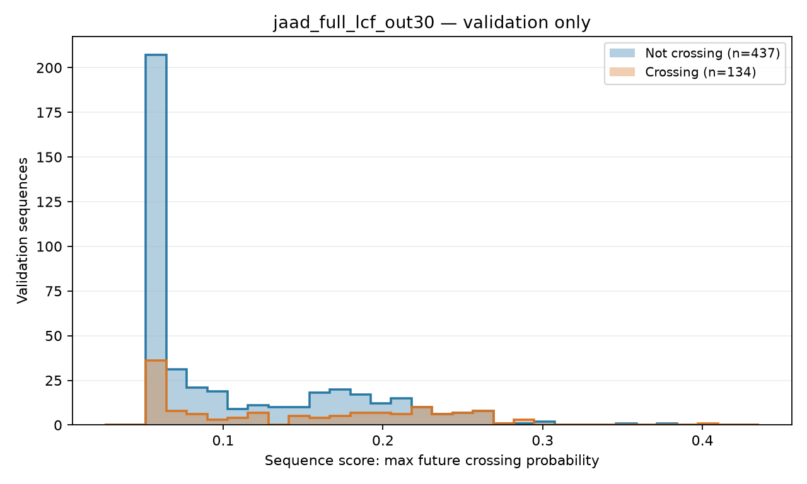
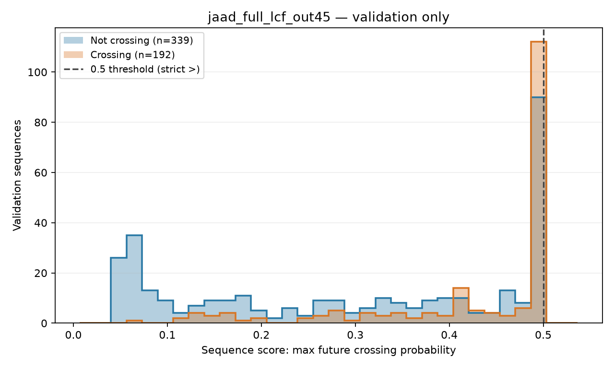

# PTINet Intention：validation-only 诊断

更新时间：2026-11-22T20:33:59.651622+09:00。本任务不读取、不评价 test，不训练，不修改已有源代码或 checkpoint。

## 运行命令

```bash
HSA_ENABLE_DXG_DETECTION=1 PYTHONDONTWRITEBYTECODE=1 python LOCAL_EXPERIMENT/PTINet/tools/diag_intention_val.py --batch-size 2 --workers 8
```

主进程逐个启动独立 run；每个子进程最多 1800 秒，超时停止整个诊断并保留结果。GPU 推理在 tmux 会话 ptinet-intention-val 中运行；日志为 driver.log 和各 run 的 .log。

## 定义与明确的实现选择

- dtype 固定 val，按每个 yml 的 input/output/stride/skip 和功能开关构造原 JAAD 类；from_file 保持配置值，save=False 防止改写原序列缓存。只访问 PN_ego/val 及其图像/光流。审计钩子拒绝打开 test 分区或 test_results/jaad_test 文件。
- 使用配置指定的最佳 checkpoint，严格加载 state_dict；net.eval()、torch.no_grad()，没有优化器。
- crossing 已经过 softmax。系列得分=max_t P(crossing=1)，标签=cross_label；逐序列验证它等于 max_t future_cross[:,:,1]。
- 原代码使用 argmax，0.5 平局归为第 0 类，因此采用严格 score > threshold，0.5 阈值逐样本与模型返回 intention 核对。阈值扫描遍历所有不同分数形成的分类划分，使用 nextafter 将 sklearn 的 >= 转为等价的严格 >；F1 并列取较高阈值。阈值 CSV 保存全部候选。
- batch=2（沿用已经验证的设置；指令允许但未要求 batch=8），workers=8、shuffle=False、pin_memory 沿用配置。drop_last=False，包含全部 val；这与 evaluate() 一致，与训练时 val loader 的 drop_last=True 有区别，避免丢弃末尾不足一个 batch 的系列。
- 固定 torch seed=0；原 VAE 在 eval 中仍使用重参数化随机采样，保留其行为，不修改模型。
- positive/negative 分位数按真实 cross_label 分组。PR-AUC 使用 average_precision_score，不是梯形积分。单类时间步的 ROC-AUC 留空并标记，不人为填成 0.5。
- best threshold/F1 是在同一个 val 上选出并评估，具有选择乐观偏差；没有在 test 上验证，不能作为 test 性能。AP 应与正例比例基线比较；平坦分数即使通过全判正类提高 F1，也不代表获得了排序能力。

## 已完成结果

| Run | val N | 正例比例 | ROC-AUC | AP | F1@0.5 | best F1 | best threshold | 时间(s) |
|---|---:|---:|---:|---:|---:|---:|---:|---:|
|jaad_full_lcf_out15|616|0.116883|0.505387|0.141139|0.000000|0.214905|0.067717149853706346|214.3|
|jaad_full_nolcf_out15|616|0.116883|0.537658|0.148071|0.000000|0.226691|0.1126214489340782|209.5|
|jaad_full_lcf_out30|571|0.234676|0.666809|0.374952|0.000000|0.443836|0.11298029124736785|177.5|
|jaad_full_lcf_out45|531|0.361582|0.727215|0.535797|0.000000|0.625532|0.39628863334655756|163.1|

- `jaad_full_lcf_out15` checkpoint：`LOCAL_EXPERIMENT/runs/jaad_full_lcf_out15/model_best0.001_512.pkl`；SHA256 `9466147e52e458d232f5a99d33e0cfab2e38fbc192ef086306ce257fa3752c35`。

- `jaad_full_nolcf_out15` checkpoint：`LOCAL_EXPERIMENT/runs/jaad_full_nolcf_out15/model_best0.001_512.pkl`；SHA256 `f4bcfcb745e80e1321d4ab0fbd84d144b6b492d2451dd8264d891a6875b46fa3`。

- `jaad_full_lcf_out30` checkpoint：`LOCAL_EXPERIMENT/runs/jaad_full_lcf_out30/model_best0.001_512.pkl`；SHA256 `c53b3921d7162abf50233e700f9a5922edcb07edaa964c1bc47f15ef0d5166e5`。

- `jaad_full_lcf_out45` checkpoint：`LOCAL_EXPERIMENT/runs/jaad_full_lcf_out45/model_best0.001_512.pkl`；SHA256 `39d45ef25a03b18ea454b52245a3e2b88105690eb8e9dbe06dec5e1ebf8fd6f1`。

## 结论：只针对本轮 validation

- 0.5 秒两组的 ROC-AUC 为 0.5054/0.5377，排序较弱；最佳 F1 为 0.2149/0.2267，与全判正类基线 0.2093 的差距较小。不能把阈值扫描提高 F1 本身当作有良好区分度的证明。
- 1.0/1.5 秒两组的 ROC-AUC 为 0.6668/0.7272，AP 为 0.3750/0.5358，高于各自正例比例基线 0.2347/0.3616。这些结果支持在本轮 val 上存在一定排序信号，不能把默认 F1=0 等同于所有配置都完全没有区分度。
- 四个 run 的所有系列得分均不超过 0.5；默认严格 >0.5 因而全部判为负类。
- out45 有 35.97% 的系列得分恰好等于 0.5，原 argmax 平局也归负类。没有把这些平局改成正类来美化 0.5 阈值指标。
- 最优阈值在同一 val 上选择，报告的是 val 内拟合结果，没有验证 test 或泛化改善。不同预测长度的 val 系列与正例比例不同，不能把跨时域的 AP/F1 差解释成同一固定样本上的性能提升。

## 最佳阈值的 Precision / Recall 与简单基线

|Run|最佳 Precision|最佳 Recall|最佳阈值判正比例|全判正类 F1|
|---|---:|---:|---:|---:|
|jaad_full_lcf_out15|0.122772|0.861111|0.819805|0.209302|
|jaad_full_nolcf_out15|0.130526|0.861111|0.771104|0.209302|
|jaad_full_lcf_out30|0.350649|0.604478|0.404553|0.380142|
|jaad_full_lcf_out45|0.528777|0.765625|0.523540|0.531120|

## 真实类别分组的系列得分分位数

|Run|真实类别|min|25%|median|75%|max|
|---|---|---:|---:|---:|---:|---:|
|jaad_full_lcf_out15|不横穿|0.0672114417|0.0677758958|0.0679233894|0.0680926461|0.0799869224|
|jaad_full_lcf_out15|横穿|0.0672548264|0.067792993|0.0679141879|0.0680767391|0.0796644017|
|jaad_full_nolcf_out15|不横穿|0.0689251572|0.11346161|0.131543115|0.139509711|0.152909383|
|jaad_full_nolcf_out15|横穿|0.0789635852|0.117844148|0.13267184|0.140868764|0.153687581|
|jaad_full_lcf_out30|不横穿|0.0542436875|0.0549817346|0.0678688288|0.16020906|0.382184833|
|jaad_full_lcf_out30|横穿|0.0544101372|0.0613640603|0.145108528|0.221415527|0.407255113|
|jaad_full_lcf_out45|不横穿|0.0434110127|0.113167897|0.325248539|0.498336866|0.5|
|jaad_full_lcf_out45|横穿|0.0623681545|0.405637905|0.5|0.5|0.5|

## 按真实类别的直方图

### jaad_full_lcf_out15



[逐步 ROC-AUC/AP](jaad_full_lcf_out15_step_metrics.csv) · [原始得分/逐步概率与标签](jaad_full_lcf_out15_scores.csv) · [全部阈值](jaad_full_lcf_out15_thresholds.csv)

### jaad_full_nolcf_out15



[逐步 ROC-AUC/AP](jaad_full_nolcf_out15_step_metrics.csv) · [原始得分/逐步概率与标签](jaad_full_nolcf_out15_scores.csv) · [全部阈值](jaad_full_nolcf_out15_thresholds.csv)

### jaad_full_lcf_out30



[逐步 ROC-AUC/AP](jaad_full_lcf_out30_step_metrics.csv) · [原始得分/逐步概率与标签](jaad_full_lcf_out30_scores.csv) · [全部阈值](jaad_full_lcf_out30_thresholds.csv)

### jaad_full_lcf_out45



[逐步 ROC-AUC/AP](jaad_full_lcf_out45_step_metrics.csv) · [原始得分/逐步概率与标签](jaad_full_lcf_out45_scores.csv) · [全部阈值](jaad_full_lcf_out45_thresholds.csv)


## 文件与身份说明

- summary.csv：全部系列级指标、分位数、每步 AUC/AP JSON 数组、checkpoint 和运行信息。
- <run>_scores.csv：每条 val 系列的原始 score/label、0.5 决策、模型 intention、最佳阈值决策及每一步概率/标签；保留 float64 文本精度，不剪裁或更改概率。精确复算可使用 pandas.read_csv(..., float_precision="round_trip")，或 JSON 中的完整阈值；不要先四舍五入阈值再声称得到完全相同的分类结果。
- <run>_step_metrics.csv：每一步的样本/正例数、ROC-AUC、AP；<run>_thresholds.csv：完整阈值扫描。
- <run>_hist.png：真实正/负类叠加直方图，二者共享 bins，坐标使用原始概率值。
- pedestrian_id：从同一 val 视频 CSV，按首帧号和 bbox 中心/宽高匹配原始 ID；仅唯一匹配时填写。多个候选原样保存在 pedestrian_id_candidates，dataset_remapped_id 始终另存。
- <run>_result.json：机器可读结果和访问过的 val CSV 清单；protected_before/after.json：train.py、datasets/、model/ 全部现有文件的哈希/mtime/大小。
- 原训练在 val 循环中没有切换 eval；本次按指令执行 net.eval()，不承诺与历史训练 val 指标完全相同。没有读取旧 test 结果作对照。
