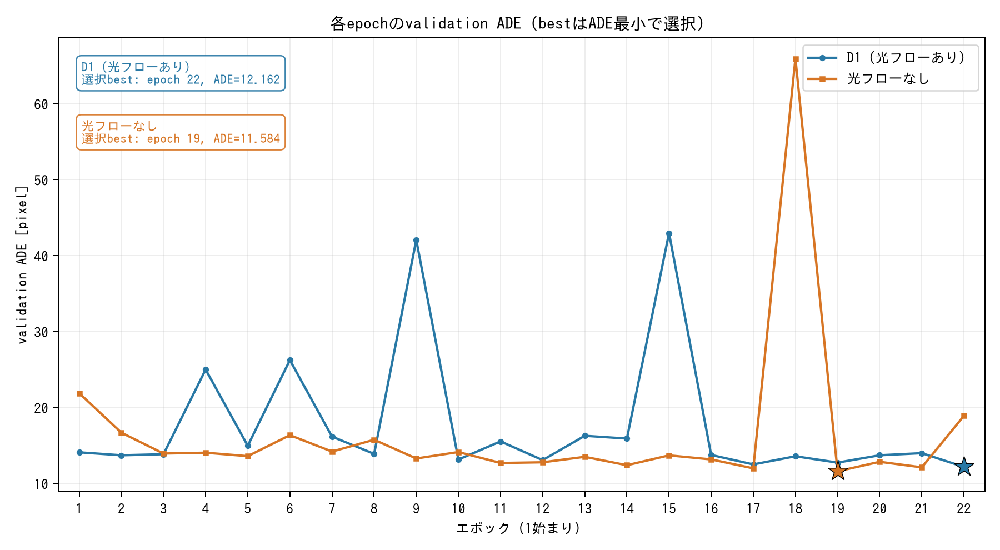
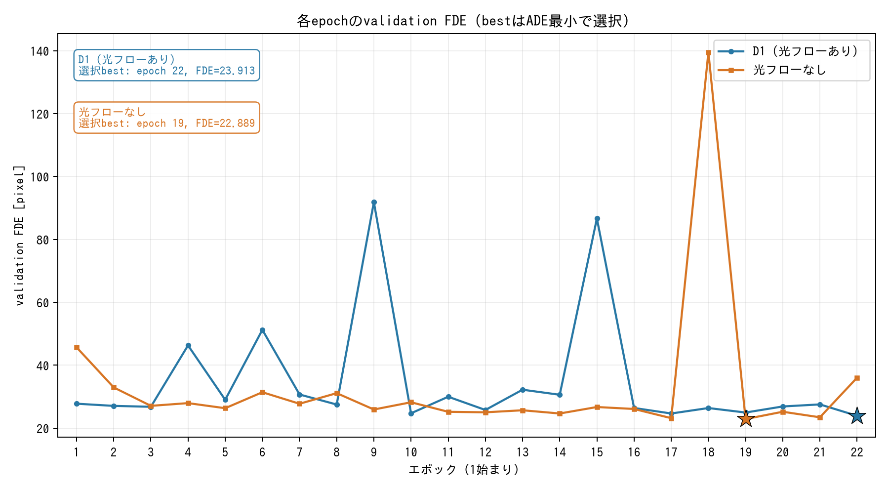

# D1 与去光流：每轮 validation 曲线

运行命令：`python LOCAL_EXPERIMENT/reports/flow_study/step4_jaad_noflow/epoch_curves/analyze.py`。纯CPU读取已有记录，不导入torch、不训练、不加载checkpoint推理、不读取test。

## 数据来源和核对

- 两边均找到各22轮完整、未四舍五入的data_final0.001_512.csv（路径/哈希见source_audit.json）。epochs.json主要保存时间，不把它误当ADE来源。
- 每轮ADE/FDE都与各自stdout日志的4位小数交叉核对，误差≤0.00005001。无需TensorBoard，也没有补跑任何评价。
- epoch_metrics.csv：epoch是原始0起始索引，epoch_number是图中的1起始轮次；包含每轮两边ADE/FDE、best标记和差值。

## 记录方式是否可比

- 两边都在每次validation前net.eval()，在torch.no_grad()下评价，结束后恢复net.train()。D1不是此前Original那种未切eval的训练。
- D1训练源码从本机Baseline git快照恢复，并与D1诊断当时保存的train.py SHA256核对一致；D1原训练发生在git建立前，不伪造其历史commit。noflow使用launch.json记录的训练commit。
- D1在源码硬编码torch.manual_seed(0)，noflow使用args.seed=0；关键训练/序列/加载器设置一致，都是全JAAD train和val、batch2、workers8、22epoch、input16/output15/stride16、原PIL W240×H426。
- 结构差异为use_opticalflow；此外noflow版本增加的尺寸/视频子集开关均保持默认全量值，改进的batch变量在Baseline全输入时已通过逐输出完全一致性检查。
- 同seed不意味着两种架构的随机初始化、训练样本次序或VAE采样流逐项完全相同：移除模块会改变随机数消耗。这是独立训练的单seed对照，不是同一模型每轮的配对干预。VAE在eval仍随机采样；训练日志每轮val还继承当时训练后的RNG状态。

## 简单统计

- 去光流ADE ≤ D1：**15/22轮**；1起始轮次=[4, 5, 6, 7, 9, 11, 12, 13, 14, 15, 16, 17, 19, 20, 21]。

|模型|best轮次（1起始）|best val ADE|最后5轮平均ADE|全22轮ADE样本标准差|ADE最大值|最大相邻轮绝对变化|
|---|---:|---:|---:|---:|---:|---:|
|D1|22|12.161542|13.225795|8.791292|42.956003|29.216788|
|noflow|19|11.583792|24.269598|11.279341|65.927177|54.343385|

样本标准差使用ddof=1；“最大值”同时提供全轮ADE最大值和最大相邻轮变化，以避免把水平与抖动混为一谈。summary.csv另含相邻差分标准差、平均绝对差分和全轮均值。最后5轮指1起始第18–22轮。

去光流的训练日志best ADE=11.5838，D1=12.1615；末5轮平均ADE差（去光流−D1）=+11.0438。结合胜出轮数15/22和标准差判断趋势，不只展示各自单个最低点。

**不能据此确认已排除偶然挑中好checkpoint。** 去光流虽在15/22轮的ADE不高于D1，但其最后5轮均值更差、全轮标准差和最大值更大；第18轮（1起始）的ADE尖峰65.9272明显影响末段均值，原样保留，不删除异常点。两边都有较大尖峰，因此单看best会掩盖训练不稳定性。

## best标记与解释边界

- 训练代码仅当ade < best_ade时保存best，故采用val ADE首次严格最小的轮次。FDE图的星号也标同一个被实际选中的checkpoint，不另挑FDE最小轮次。
- 这些是训练过程中记录的每轮val值，与后来固定seed重新推理最佳checkpoint得到的12.1355/11.6186等数值不是同一条RNG轨迹，不能强行要求数值相等，也不能据此误判checkpoint选错。
- 本分析可检查是否多个epoch、末5轮或总体抖动也支持同样趋势；仅两条单seed曲线不能证明已排除“偶然好checkpoint”或训练随机性。轮次相互相关，不把22轮视作22次独立训练或额外做伪配对显著性检验。

## 图表

